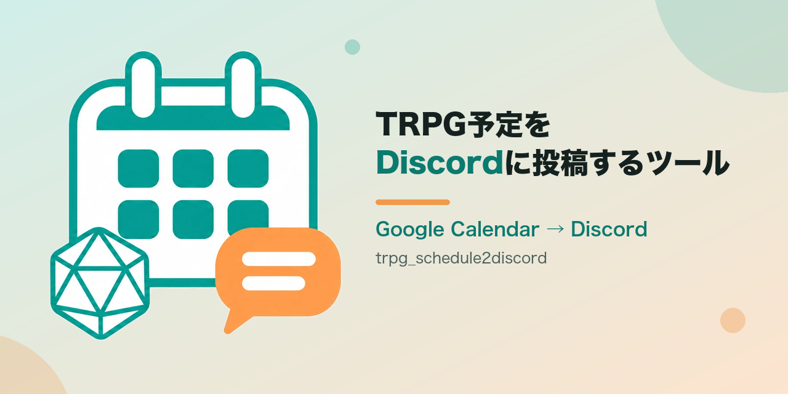

# TRPG予定をDiscordに投稿するツール



Google カレンダーに入れている TRPG セッションの予定を、月ごとにまとめて Discord に自動で投稿する Google Apps Script です。
毎月1回、今月から6か月分の予定を投稿します。

「今どのシナリオを回していて、次はいつ何があるか」を、サーバーの仲間にまとめて知らせたいときに使えます。

> [!TIP]
> 作った経緯と使い方は、note 記事にまとめています。
> 📝 [TRPGのセッション予定を、毎月Discordに自動でお知らせする仕組みを作りました](https://note.com/shizaki_kanoto/n/n4dfad1d104dd)

## できること

- Google カレンダーの予定を、月ごとにまとめて Discord に投稿する
- 同じ月に同じシナリオが何回あっても、1件にまとめて表示する
- 予定の説明に決めた文字（例：`GM：自分の名前`）があれば「GM」、なければ「PL」と表示する（任意）
- 投稿の最後に、空き日程の表などへのリンクやお知らせを載せる（任意）
- 毎月決まった日時に自動で投稿する

投稿はこのような形になります。

```
🎲 セッション予定
今後6か月分のTRPG予定をまとめました。

📅 2026年11月
・シナリオA（GM）
・シナリオB（PL）

📅 2026年12月
・シナリオC（PL）

📌 空き日程の確認はこちら
https://example.com/
空き枠の公開は当月〜翌月を目安にしています。
```

## 必要なもの

- Google アカウント（セッション予定を入れているカレンダー）
- 投稿先の Discord サーバー（Webhook を作れる権限が必要です）

どちらも無料で使えます。コードを書く必要はなく、ファイルの中身を Apps Script に貼り付けて設定するだけです。

> [!TIP]
> セッション予定だけを入れたカレンダーを1つ作っておくのがおすすめです。
> 仕事や私用の予定と同じカレンダーを指定すると、それらも投稿されてしまいます。

## 安全性について

- Discord の Webhook URL やカレンダー ID は、自分の Apps Script の「スクリプト プロパティ」にだけ保存します。作者を含め、ほかの人に送られることはありません。
- 通信先は、設定した Discord の Webhook だけです。
- 投稿されるのは、予定のタイトルと月だけです。日付・時刻・説明・参加者は投稿しません（説明は GM / PL の判定にだけ使います）。

## セットアップ

1. [Google Apps Script](https://script.google.com/) で「新しいプロジェクト」を作る
2. `src/Code.js` の中身を、エディタの `コード.gs` に丸ごと貼り付けて保存する
3. エディタ左の「プロジェクトの設定」で「「appsscript.json」マニフェスト ファイルをエディタで表示する」にチェックを入れ、`appsscript.json` の中身を `src/appsscript.json` に置き換える
   （[clasp](https://github.com/google/clasp) を使う場合は `.clasp.json` の `rootDir` を `src` にして `clasp push`）
4. Discord で投稿先チャンネルの「チャンネルの編集」>「連携サービス」>「ウェブフック」から Webhook を作り、URL をコピーする
5. Google カレンダーの「設定と共有」>「カレンダーの統合」にある「カレンダー ID」をコピーする
6. 「プロジェクトの設定」>「スクリプト プロパティ」に以下を登録する

   | キー | 必須 | 内容 |
   | --- | --- | --- |
   | `CALENDAR_ID` | ○ | セッション予定を入れているカレンダーの ID |
   | `DISCORD_WEBHOOK_URL_PROD` | ○ | 投稿先チャンネルの Webhook URL |
   | `DISCORD_WEBHOOK_URL_TEST` | | 試し投稿用チャンネルの Webhook URL |
   | `GM_KEYWORD` | | 予定の説明にこの文字があれば GM、なければ PL と表示する（例：`GM：自分の名前`）。未設定なら GM / PL を表示しない |
   | `FOOTER_TITLE` | | 最後に載せるお知らせの見出し（未設定なら `📌 お知らせ`） |
   | `FOOTER_URL` | | 最後に載せるリンク（空き日程の表など） |
   | `FOOTER_TEXT` | | 最後に載せる文章（改行したいところは `\n` と書く） |

7. 試しに投稿する
   - `DISCORD_WEBHOOK_URL_TEST` を設定した場合は、エディタ上部の関数から `testSendTRPGScheduleToDiscord` を選んで「実行」する
   - 設定していない場合は `sendTRPGScheduleToDiscord` を実行すると、本番のチャンネルに投稿されます
   - 初回はカレンダーと外部への通信の許可を求められるので、自分のアカウントで許可する
8. `setupMonthlyTrigger` を一度だけ実行して、毎月の自動投稿を登録する（初期値は毎月1日の9時台）

## 関数

| 関数 | 用途 |
| --- | --- |
| `sendTRPGScheduleToDiscord` | 本番のチャンネルに投稿する（毎月のトリガーから呼ばれる） |
| `testSendTRPGScheduleToDiscord` | 試し投稿用のチャンネルに同じ内容を投稿する |
| `setupMonthlyTrigger` | 毎月の自動投稿を登録し直す（何度実行しても1つだけになる） |

## 変えられる設定

`src/Code.js` の先頭で変えられます。

| 定数 | 初期値 | 内容 |
| --- | --- | --- |
| `MONTHS` | `6` | 今月から何か月分を載せるか |
| `TRIGGER_DAY` / `TRIGGER_HOUR` | `1` / `9` | 毎月何日の何時台に投稿するか（変えたら `setupMonthlyTrigger` を実行し直す） |
| `TIME_ZONE` | `Asia/Tokyo` | 日付を判定するタイムゾーン |
| `EMBED_TITLE` / `EMBED_COLOR` | `🎲 セッション予定` / 青紫 | 投稿の見出しと色 |

## うまくいかないとき

| 症状 | 確認すること |
| --- | --- |
| `スクリプトプロパティ「…」が設定されていません` | キーの名前が表と同じか（大文字・小文字も含めて） |
| `カレンダー「…」が見つかりません` | カレンダー ID が正しいか。共有されたカレンダーの場合は、自分に閲覧権限があるか |
| `Discord error 401` / `404` | Webhook URL が正しいか。Webhook を削除していないか |
| 毎月の投稿が来ない | エディタ左の「トリガー」に `sendTRPGScheduleToDiscord` があるか |

予定が多くて Discord の文字数の上限を超える場合は、「（続き）」として分けて、複数回に分けて投稿します。

## 質問・不具合の報告

分かりにくいところや動かないところがあれば、[Issue](https://github.com/shizaki-kanoto-lab/trpg_schedule2discord/issues) で気軽に教えてください。

## ライセンス

[MIT License](LICENSE)
